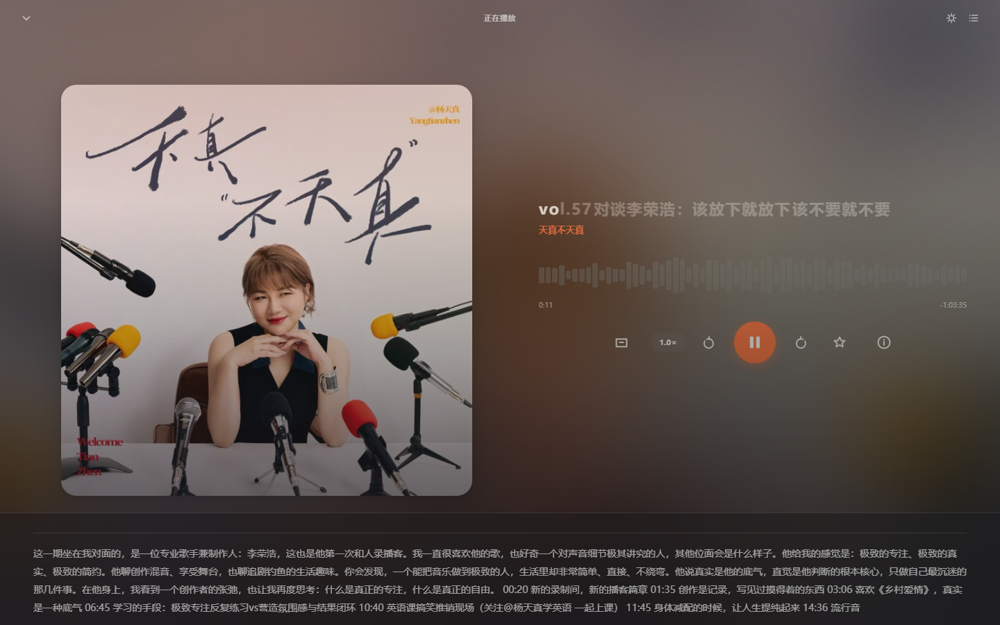

# 小宇宙 Web 版

把 [小宇宙](https://www.xiaoyuzhoufm.com) 播客客户端搬到浏览器里的单文件 Web 应用 —— 三栏 macOS 原生布局、Liquid Glass 材质、**数据实时同步**、**真实音频播放**。

> 单文件、零构建、零依赖。双击 `index.html` 即可运行。

## 桌面版

除网页版外，仓库内还包含 **Electron 桌面版**（`desktop/`），可打包为 **Windows `.exe`** 与 **macOS `.dmg`**：

```bash
cd desktop
npm install
npm run build:win      # Windows
npm run build:mac      # macOS（需在 macOS 上执行）
```

桌面版的关键优势是**主进程直连小宇宙官方接口**，不受浏览器 CORS 限制，因此支持**手机号 + 短信验证码真实登录**。详见 [`desktop/README.md`](desktop/README.md)。

## 跨端可用

同一份代码，在所有主流设备上都能用：

| 平台 | 状态 | 说明 |
|---|---|---|
| **PC**（Windows / macOS / Linux） | ✅ | 桌面端完整体验，三栏布局 + 键盘快捷键 |
| **Mac** | ✅ | 独立窗口（`workbuddy.link` 直接打开即为应用窗口） |
| **安卓** | ✅ | 移动端布局：侧边栏收起、封面与详情单列堆叠 |
| **iOS / iPadOS** | ✅ | 移动端布局，可「添加到主屏幕」当作 PWA 使用 |

响应式断点：`< 1000px` 自动切换为移动端单列布局，封面、波形、控件依次纵向排列。



## 特性

### 数据实时更新
不是构建时的静态快照 —— 打开即拉最新数据：

- **7644 档节目** 全库目录（榜单 rank 1–7717），排行榜与搜索直接基于它
- **7447 档节目预置封面 URL**（97.4%），搜索结果与排行榜直接出图，不等网络
- 内置 **38 档节目的 532 条单集**（含音频地址）作为首屏兜底
- 节目详情、单集列表、音频地址、订阅数**打开即实时拉取**
- 启动时后台并发同步 60 档种子节目（失败自动重试并换源）
- 点开任意节目按需拉取实时详情，封面也是实时的

### 真实音频播放
`<audio>` 元素直连小宇宙官方 CDN：

- 流式播放（服务端支持 Range 分段请求），不必等整段下载
- 倍速 / 后退 15s / 前进 30s / 音量拖拽 / 进度拖拽定位
- 播完自动续下一集，睡眠定时已移除（改为深浅外观切换）

### 扫码登录
Liquid Glass 弹窗，二维码 + 120 秒倒计时：

`等待扫码 → 已扫码待确认 → 登录成功`

**登录说明（重要）**：当前弹窗内提供「模拟扫码」按钮，用于走通完整交互流程。要接入**真实的小宇宙账号登录**，必须解决跨域限制：

- 小宇宙的认证接口（`web-api.xiaoyuzhoufm.com` / `api.xiaoyuzhoufm.com`）**不返回 CORS 头**，浏览器直连必然失败
- 需要一个服务端代理转发请求（Cloudflare Worker / Vercel / Edge Function 均可），把 `Authorization` 等请求头由服务端注入
- 网页版提供的 `/web/user/login-with-wechat-js-sdk` 依赖微信 JS SDK，桌面浏览器不可用；需要 App 端的扫码接口

因此本项目**不内置**真实登录，避免做出一个看起来能登录、实则永远失败的假功能。代理层接入后，把二维码请求与轮询接口指向代理即可，UI 与状态机无需改动。

### 其他
- **播放历史**：记录播放位置与进度条，按日期分组，支持续播、单条删除、清空
- **封面取色背景**：canvas 提取封面主色调，生成氛围渐变背景，深浅色各自调浓度
- **双击播放**：卡片 / 排行榜封面双击直接播放最新单集
- **播放详情页**：点击左下角封面全屏展开 —— 左半屏 75% 放大封面、右半屏垂直居中的详情、底部通栏播放条
- **长按拖拽进度条**：波形处长按进入拖拽态，波形放大并显示定位气泡，跟随指针精确定位
- **深浅外观**：跟随系统 / 浅色 / 深色三态循环，选择持久化；播放页右上角可快速两态互切
- **封面色背景**：按封面主色调生成三段渐变，深浅主题各配一套浓度
- 键盘快捷键：`空格` 播放暂停、`←→` 快进快退、`⌘F` 搜索、`JKL` 上下曲

## 目录结构

```
index.html          # 完整应用（单文件，含内联数据与样式）
src-template.html   # 源码模板（数据以 __DATA__ 等占位符注入）
docs/               # 截图
build.py            # 构建脚本：注入数据 + 安全自检
```

### 构建

```bash
python3 build.py
```

脚本在生成 `index.html` 后会自动自检：script 标签配对、JSON 块可解析且无未转义 `</script`、
节目 pid 全部为 24 位合法 hex、主 script 通过 `node --check` 语法校验、关键 DOM 元素齐全。

## 数据来源

- 节目 / 单集 / 订阅数 / 音频地址：[小宇宙公开页面](https://www.xiaoyuzhoufm.com)
- 节目总目录：公开订阅数据聚合站（rank 1–7717）
- 封面主色调：构建时离线计算（`ffmpeg` 采样 + HSL 分桶），运行时直接用，零跨域风险

## 技术要点

**纯前端跨域直读**。小宇宙对 `/podcast/{id}` 与 `/_next/data/{buildId}/...` 返回 `Access-Control-Allow-Origin` 回显任意 Origin，浏览器可直读，无需后端代理。

**登录接口受限**。认证类接口走 `web-api.xiaoyuzhoufm.com` / `api.xiaoyuzhoufm.com`，这两个域**不返回任何 CORS 头**（OPTIONS 预检 204 但无 `Access-Control-Allow-Origin`），浏览器无法跨域直连；真实登录必须经过服务端代理。详见下方「登录说明」。

**封面主色预置 + 运行时兜底**。托管域名的 CORS 是回显具体 Origin 而非 `*`，本地开发时 canvas 会被污染 —— 因此主色在构建时离线算好写入数据，运行时 canvas 取色仅作兜底。

**布局尺寸由 JS 计算**。需要严格 1:1 正方形且不溢出父容器时，CSS 无法同时用「父宽百分比」和「父高」约束一个元素并保持 `aspect-ratio`（`max-height` 会把正方形压扁），故用 JS 写入像素宽高。

## 桌面版构建校验

`desktop/check.py` 在打包前自动检查：脚本语法（node --check）、script 标签配对、JSON 块可解析、顶层重复声明、关键 DOM id 齐全。

## 致谢

- [小宇宙](https://www.xiaoyuzhoufm.com) —— 内容与音频来源
- Apple Human Interface Guidelines —— 布局与交互范式

## 免责声明

本项目为技术演示，非小宇宙官方应用。音频版权归原作者所有，节目数据来自公开页面。
